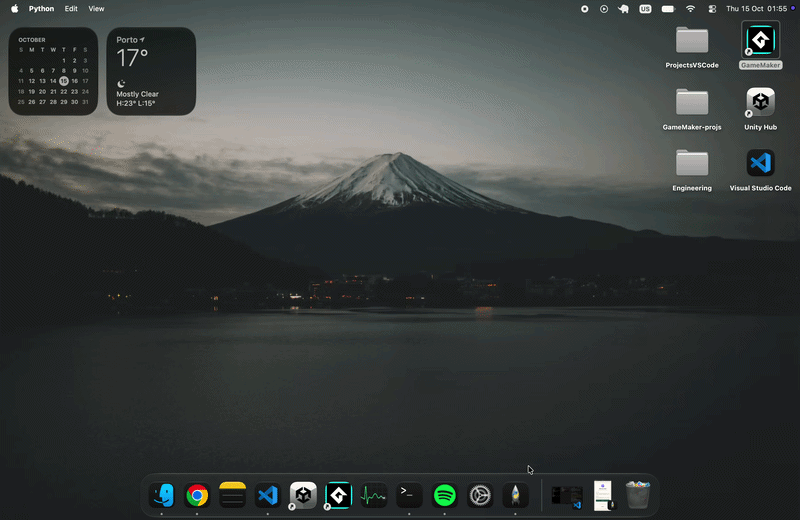

# Plume
## Social App that allows friends to answer daily questions together and keep an archive of their answers.


## Core Idea:

### Implemented
* User registers,
* User logs in,
* User gets daily question and answers,
* User has an archive with all the questions he answered and what was answered.

### To Implement
* Friend requests
* Access to friend's archive

## Tech Stack
```
- **Frontend:** JavaScript > React(Vite)
- **Backend:** Python > Flask + Flask-CORS and Werkzeug(for the password hashing).
```

## Setup

Prerequisites: Python, PostgreSQL, Ollama (with the llama3.2 model), and Node.js with npm.

### Backend Setup
```
cd backend
pip install -r requirements.txt

# run the flask sv:

python app.py => Windows/Linux *Recomended
python3 app.py => on macOS
```


## Frontend Setup
```
cd frontend
npm install
npm run dev
```
