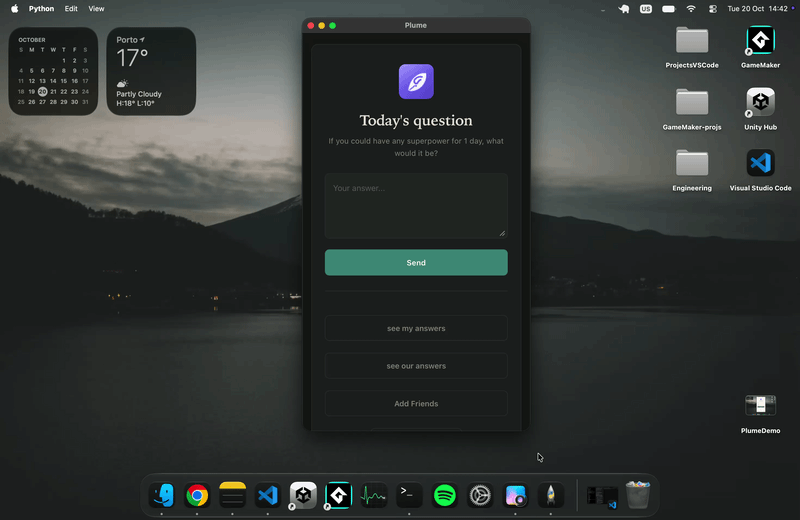

# Plume
## Social App that allows friends to answer daily questions together and keep an archive of their answers.


Note: planned for self-hosting on a home server with a local Ollama model, so there’s no public demo for now.

## Core Idea:

### Implemented
* User registers,
* User logs in,
* User gets daily question and answers,
* User has an archive with all the questions he answered and what was answered,
* Friend requests,
* Access to friend's archive.


## Tech Stack
```
- **Frontend:** JavaScript > React(Vite)
- **Backend:** Python > Flask + Flask-CORS and Werkzeug(for the password hashing).
- **Database and AI** > PostgreSQL (Relational database) and Ollama (Local `llama3.2` LLM orchestration).
```

## Setup

Prerequisites: Python, PostgreSQL, Ollama (with the llama3.2 model), and Node.js with npm.

### Backend Setup
```
cd backend
pip install -r requirements.txt

# run the flask sv:

python app.py => Windows/Linux *Recomended
python3 app.py => on macOS
```


## Frontend Setup
```
cd frontend
npm install
npm run dev
```


  What I can conclude form this project:

I was inspired by Locket and similar projects that use a daily mechanic to interact with friends. As an "archive guy," I figured seeing what my friends and I had to say on the same subject every day would be interesting.

I tried building it, and at first, it was smooth sailing - just basic POST requests where you type something and it gets stored.

When it came to registration and logins, I hit a small wall since I had never done that before, but Werkzeug facilitated that part.

The only place I really struggled with was friend requests and managing both tables at the same time for the "our answers" section.

I believe I was suffering from code blindness at the time.

I won't deploy this project just yet because I want to use my own server to have full control and use the Ollama model to my liking.
I will keep it updated, but until the beta goes live, I am not going to touch it much.
